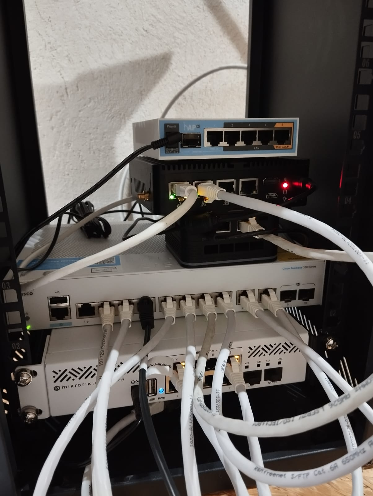

# pfSense High Availability - HomeLab

## Opis projektu

Projekt ten przedstawia konfigurację redundantnego środowiska sieciowego opartego na **pfSense** w trybie **High Availability (HA)**.  
Celem było zapewnienie ciągłości dostępu do internetu w przypadku awarii głównego ISP poprzez konfigurację jednego ISP i implementację High Availability z wykorzystaniem **CARP** dla **VIP** (Virtual IP) oraz synchronizację konfiguracji i reguł firewalla między dwoma pfSense za pomocą **XML-RPC** i **pfsync**.

## Kluczowe cechy

- **HA (High Availability)** z **CARP VIP** – zapewnia redundancję i automatyczne przejęcie roli firewalla w przypadku awarii głównego urządzenia.
- **Jedno ISP** – wykorzystanie jednego łącza ISP z redundancją dzięki trybowi HA.
- **Synchronizacja XML-RPC i pfsync** – konfiguracja firewalla, reguły, aliasy, DHCP i NAT synchronizowane między dwoma urządzeniami pfSense.

## Schemat sieci

Lab dotyczy zaznaczonej na czerwono części:

## Technologie i koncepcje

### Technologie

- pfSense Community version
- CARP (Common Address Redundancy Protocol)
- XML-RPC Synchronizacja
- pfsync (Firewall Sync)
- Virtual IP (VIP)
- Proxmox (dla wirtualnej maszyny)
- Fizyczny sprzęt (dla drugiego pfSense)
- Git do wersjonowania konfiguracji

### Kluczowe pojęcia

- **High Availability (HA)** – redundantne urządzenia zapewniające ciągłość działania.
- **Failover** – automatyczne przełączenie na zapasowe urządzenie w razie awarii.
- **CARP VIP** – wspólny wirtualny adres IP, który jest przechwytywany przez aktywnego firewalla w środowisku HA.
- **pfsync** – synchronizacja stanu połączeń i reguł firewall w HA.
- **XML-RPC Sync** – synchronizacja konfiguracji (np. reguł, aliasów) między masterem a slave'em.

## Jak uruchomić?

### 1. Wymagania

- 2x urządzenia pfSense:
  - 1x na **Proxmox** (wirtualna maszyna)
  - 1x na **fizycznym sprzęcie**
- 1x łącze ISP
- Środowisko testowe: **Fizyczny Lab**

### 2. Konfiguracja pfSense

**Na Masterze (fizyczny sprzęt):**

- Ustawienie CARP VIP na interfejsie WAN
- Włączenie synchronizacji XML-RPC Sync
- Skonfigurowanie jednego ISP

**Na Slave (wirtualna maszyna na Proxmoxie):**

- Skonfigurowanie interfejsu synchronizacji
- Aktywacja synchronizacji konfiguracji z Masterem

### 3. Testy

- Po dodaniu i synchronizacji reguł oraz konfiguracji, przetestuj failover urządzeń i przełączenie ról firewalla.
- Sprawdź w logach, czy synchronizacja działa poprawnie, a reguły są przekazywane na SLAVE.

## Co bym zrobił inaczej w produkcji?

Chociaż ten projekt sprawdza się w środowisku testowym, w produkcji warto zwrócić uwagę na:

- Wprowadzenie **monitoringu** (np. Zabbix, Nagios) do monitorowania stanu urządzeń oraz łącza ISP.
- Przejście na **dynamiczny routing** w przypadku awarii ISP (np. OSPF lub BGP), by zautomatyzować proces failover.
- Testowanie pełnej redundancji z dodatkowym sprzętem (np. UPS, redundantne zasilanie).

## Autorzy

Projekt stworzony przez **genngott** w celach edukacyjnych i testowych.

## Licencja

MIT License. See [LICENSE](LICENSE) for more information.

---

## Uwagi

- Projekt zakłada, że jedno z urządzeń działa na **Proxmoxie**, a drugie na **fizycznym sprzęcie**, co zapewnia różnorodność konfiguracji, ale zachowuje pełną funkcjonalność w trybie HA.
- Powyższa konfiguracja jest przeznaczona do jednego ISP. Dla pełnej redundancji z dwoma ISP, należy dostosować konfigurację o dodatkowy failover dla łączy ISP (ale to temat na kolejny lab).
