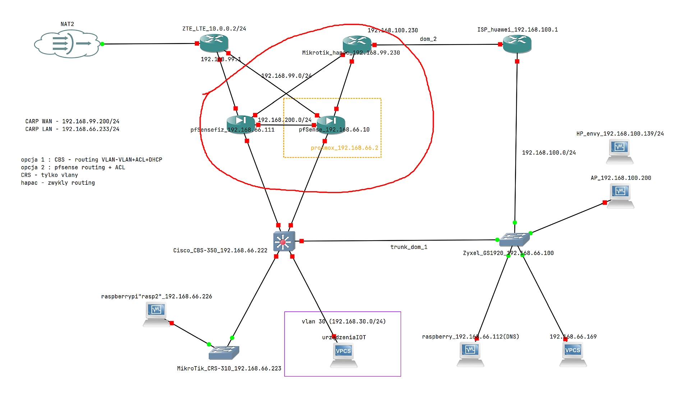
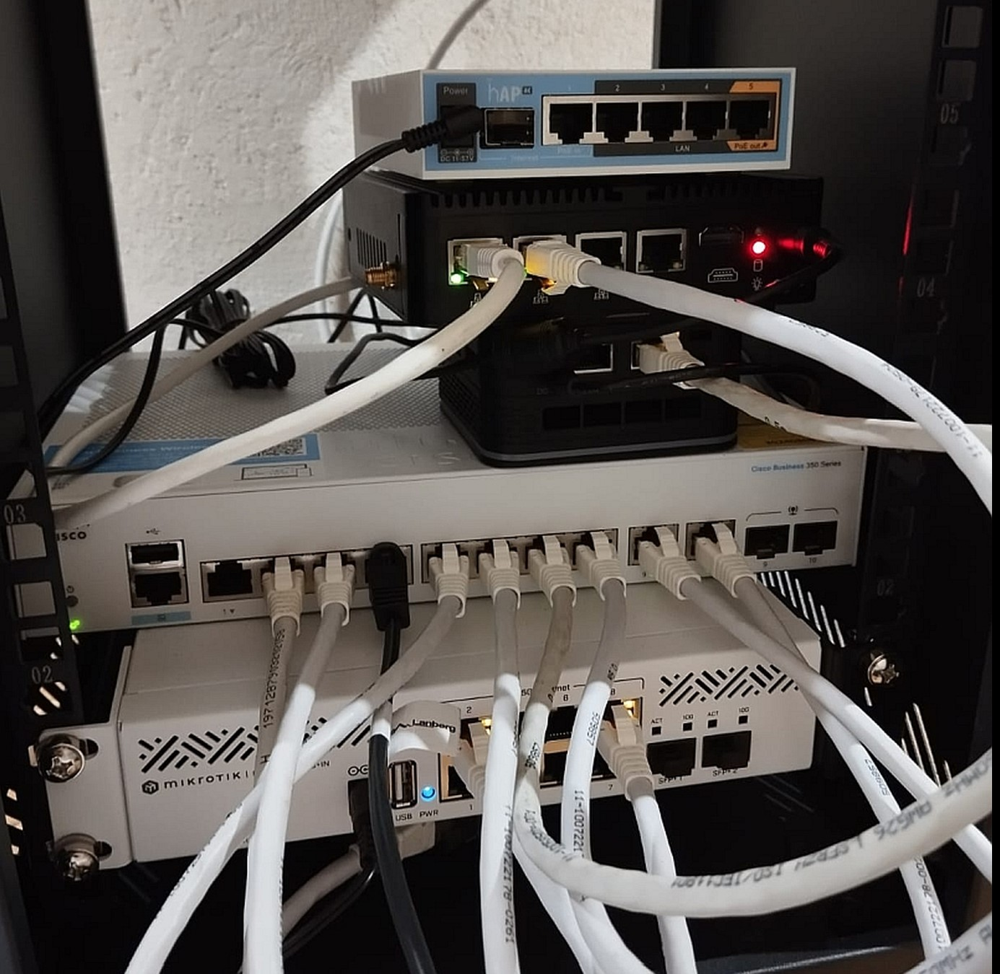
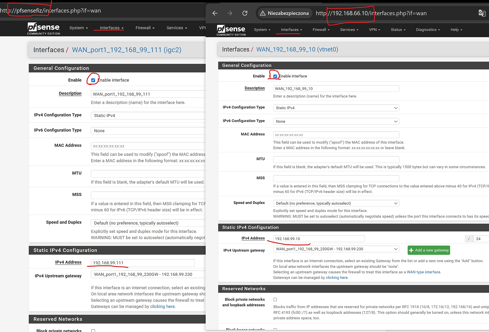
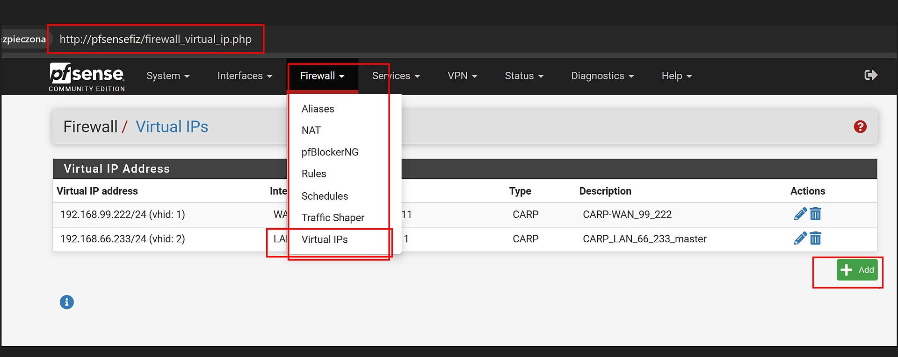
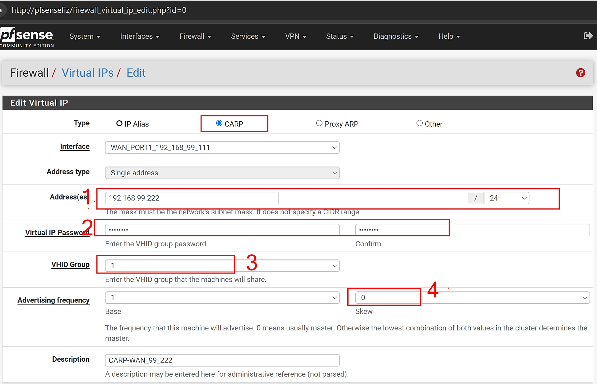
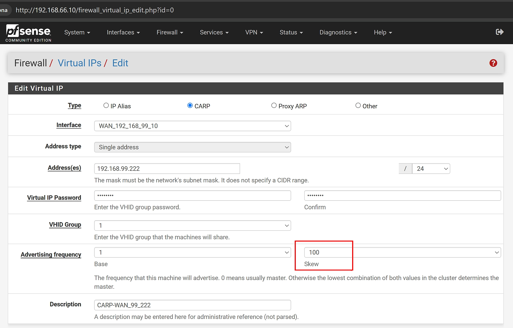

# pfSense High Availability - HomeLab

## Opis projektu

Projekt przedstawia konfigurację redundantnego środowiska sieciowego opartego na **pfSense Community** w trybie **High Availability (HA)**.  
Celem było zapewnienie ciągłości dostępu do internetu w przypadku awarii jednego firewalla poprzez konfigurację i implementację High Availability z wykorzystaniem **CARP** dla **VIP** (Virtual IP) oraz synchronizację konfiguracji i reguł firewalla między dwoma pfSense za pomocą **XML-RPC** i **pfsync**.

## Kluczowe cechy

- **HA (High Availability)** z **CARP VIP** – zapewnia redundancję i automatyczne przejęcie roli firewalla w przypadku awarii głównego urządzenia.
- **Jedno ISP** – wykorzystanie jednego łącza ISP z redundancją dzięki trybowi HA.
- **Synchronizacja XML-RPC i pfsync** – konfiguracja firewalla, reguły, aliasy, DHCP i NAT synchronizowane między dwoma urządzeniami pfSense.

## Schemat sieci

Lab dotyczy zaznaczonej na czerwono części:

## Technologie i koncepcje

### Technologie

- pfSense Community version
- CARP (Common Address Redundancy Protocol)
- XML-RPC Synchronizacja
- pfsync (Firewall Sync)
- Virtual IP (VIP)
- Proxmox (dla wirtualnej maszyny)
- Fizyczny sprzęt (dla drugiego pfSense)

### Kluczowe pojęcia

- **High Availability (HA)** – redundantne urządzenia zapewniające ciągłość działania.
- **Failover** – automatyczne przełączenie na zapasowe urządzenie w razie awarii.
- **CARP VIP** – wspólny wirtualny adres IP, który jest przechwytywany przez aktywnego firewalla w środowisku HA.
- **pfsync** – synchronizacja stanu połączeń i reguł firewall w HA.
- **XML-RPC Sync** – synchronizacja konfiguracji (np. reguł, aliasów) między masterem a slave'em.

## Jak uruchomić?

### 1. Wymagania

- 2x urządzenia pfSense:
  - 1x na **Proxmox** (wirtualna maszyna)
  - 1x na **fizycznym sprzęcie**
- 1x łącze ISP (w kolejnym labie przewidziane drugi ISP jako połaczenie LTE)
- Środowisko testowe: **Fizyczny Lab** 

### 2. Konfiguracja pfSense

**Na Masterze (fizyczny sprzęt):**

- Ustawiłem CARP VIP na interfejsie WAN
- Włączyłem synchronizację XML-RPC Sync

**Na Slave (wirtualna maszyna na Proxmoxie):**

- Skonfigurowaęłm interfejs synchronizacji
- Aktywacja synchronizacji konfiguracji z Masterem

### 3. Testy

- Po dodaniu i synchronizacji reguł oraz konfiguracji, test failover urządzeń i przełączenie ról firewalla.
- Sprawdzenie w logach, czy synchronizacja działa poprawnie i czy reguły są przekazywane na SLAVE.

## Co bym zrobił inaczej w produkcji?

Chociaż ten projekt sprawdza się w środowisku testowym, w produkcji warto zwrócić uwagę na:

- Wprowadzenie **monitoringu** (np. Zabbix, Nagios) do monitorowania stanu urządzeń oraz łącza ISP.
- Przejście na **dynamiczny routing** w przypadku awarii ISP (np. OSPF lub BGP), by zautomatyzować proces failover.
- Testowanie pełnej redundancji z dodatkowym sprzętem (np. UPS, redundantne zasilanie).

### 4. Szczegóły konfiguracji i przebieg wdrożenia

1. **Przygotowanie infrastruktury:**
   - Mam dwie maszyny, z których MASTER (pfsensefiz) działa na fizycznym sprzęcie i SLAVE-tudzież BACKUP (192.168.66.10) postawiony na Proxmox VE na mini PC  
   - Oba mają skonfigurowane interfejsy sieciowe WAN w tej samej podsieci (192.168.99.0/24) 
   

2. **Konfiguracja CARP:**
   - CARP (Common Address Redundancy Protocol) to odpowiednik protokołu CISCO VRRP czyli protokół który odpowiada za jakby nie patrzeć redundancję ;)
   - Na obu urządzeniach pfSense, skonfigurowałem wspólny adres VIP dla interfejsów WAN, który będzie używany przez urządzenia w trybie HA i ten adres wstrzykiwany jest przez DHCP do endpointów 

   - pkt 1. Wspólny adres Virtual IP dla obu maszyn 
   - pkt 2. Hasło na obu maszynach takie samo - pełni rolę uwierzytelnienia maszyn
   - pkt 3. Numer grupy w której znajdują sią obie maszyny - również taki sam dla obu
   - pkt 4. SKEW - określa która maszyna to MASTER a która SLAVE. Niższy numer=wyższy priorytet (czyli np 0=Master a 100=Slave)
    
   
3. **Synchronizacja XML-RPC i pfsync:**

   - Skonfiguruj synchronizację ustawień, reguł firewalla, NAT i aliasów pomiędzy urządzeniami za pomocą XML-RPC. Włącz synchronizację stanu połączeń oraz reguł firewalla z wykorzystaniem pfsync.

4. **Testowanie failover:**
   - Przetestuj proces przełączania się na zapasowy firewall w przypadku awarii urządzenia głównego. Upewnij się, że synchronizacja reguł działa poprawnie, a połączenia są nadal utrzymywane.

5. **Optymalizacja i dodatkowe usprawnienia:**
   - Po skonfigurowaniu podstawowej funkcjonalności, przemyśl implementację monitoringu i dynamicznego routingu, które dodatkowo zwiększą niezawodność i automatyzację failoveru.

## Autorzy

Projekt stworzony przez **genngott** w celach edukacyjnych i testowych.

## Licencja

MIT License. See [LICENSE](LICENSE) for more information.

---

## Uwagi

- Projekt zakłada, że jedno z urządzeń działa na **Proxmoxie**, a drugie na **fizycznym sprzęcie**, co zapewnia różnorodność konfiguracji, ale zachowuje pełną funkcjonalność w trybie HA.
- Powyższa konfiguracja jest przeznaczona do jednego ISP. Dla pełnej redundancji z dwoma ISP, należy dostosować konfigurację o dodatkowy failover dla łączy ISP (ale to temat na kolejny lab).
